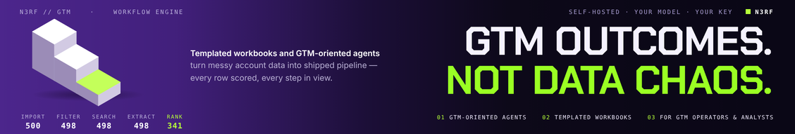
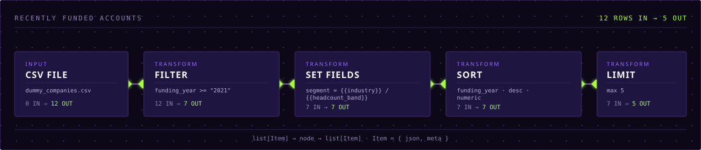

<p align="center">
  
</p>

<h1 align="center">n3rf</h1>

<p align="center"><strong>The self-hosted, AI-assisted workflow builder.</strong><br>
Messy input in, structured rows out — on your own machine, with your own model and key.</p>

<p align="center">
  <a href="https://github.com/Mohammad-Asaad-Sayed/n3rf/actions/workflows/ci.yml"></a>
  <a href="./LICENSE"></a>
  <a href="https://www.python.org/downloads/"></a>
</p>

<p align="center">
  <a href="./docs/self-hosting.md">Self-hosting guide</a> ·
  <a href="./examples/">Examples</a> ·
  <a href="./SECURITY.md">Security</a> ·
  <a href="https://github.com/Mohammad-Asaad-Sayed/n3rf/issues">Issues</a> ·
  <a href="./LICENSE">AGPL-3.0</a>
</p>

n3rf is an open-source workspace for row-shaped data: upload a CSV, paste cells, or start from a
blank canvas, chain import → transform → AI nodes on a visual canvas, and run the whole thing
locally. Your provider key stays in your environment — it is never saved with workflows, run
history, or logs. n3rf is built for operators who want enrichment pipelines without handing their
data to a hosted service.

## See it run

<p align="center">
  = 2021 (7 rows) → Set Fields adds a segment column → Sort by funding_year descending → Limit to 5 rows. Each node shows rows in and out." width="100%">
</p>

The sample list from [`examples/dummy_companies.csv`](./examples/dummy_companies.csv) — import,
filter, set fields, sort, limit — with the row count tracked at every step. Rebuild it in the
editor, or run `examples/demo.py` for a full AI-node pipeline.

## Run it

You need **Python 3.12+**, **Git**, and **Node.js with pnpm** (to build the frontend once).
The default demo needs no API key.

```bash
git clone https://github.com/Mohammad-Asaad-Sayed/n3rf.git
cd n3rf
./scripts/setup.sh
./scripts/run.sh
```

Open [http://127.0.0.1:8000](http://127.0.0.1:8000). The self-hosted workspace and the API are
served from the same origin; the OpenAPI docs are at
[`/docs`](http://127.0.0.1:8000/docs).

To wire up AI nodes (or verify a provider), export a key first, e.g.
`export OPENAI_API_KEY="..."`, or copy `.env.example` to `.env` — `./scripts/run.sh` loads it
automatically. Keys are read at run time and are never written to workflow JSON. Any
OpenAI-compatible endpoint works, including local models (e.g. Ollama — no key needed).

<details>
<summary>Manual setup (no scripts)</summary>

```bash
python3 -m venv .venv
. .venv/bin/activate
pip install -r requirements-dev.txt
cd frontend
pnpm install
pnpm run build
cd ..
uvicorn app.main:app --port 8000
```

</details>

<details>
<summary>Local development</summary>

Run FastAPI on port 8000 and the Vite dev server separately — it proxies API requests to FastAPI:

```bash
.venv/bin/uvicorn app.main:app --reload --port 8000   # API on :8000
cd frontend && pnpm dev                                # editor dev server with HMR
cd ../site && pnpm dev                                 # marketing site, independent build
```

The self-hosted app is built from `frontend/dist` and served by FastAPI. The public marketing
site builds to `site/dist` and deploys independently to any static host. When no provider can
currently be reached, the workspace home shows a hint and `GET /models/status` returns
`{"ready": false}` — and if the API is unreachable entirely, the editor runs in an explicitly
labeled simulated mode (amber banner, amber LED, `· simulated` in the run meta). See
[SECURITY.md](./SECURITY.md) for vulnerability reporting and deployment notes.

</details>

## What you get

- **Rows are the unit.** Every node receives `list[Item]` and returns `list[Item]` —
  `Item = {json, meta}`, with lineage and engine bookkeeping kept out of your export columns.
- **36 nodes, one contract.** Import (CSV, spreadsheet paste, text, JSON), transform nodes
  (Filter, Sort, Limit, Set Fields, Aggregate, Deduplicate, …), 5 search/scrape nodes (Tavily,
  Exa, SerpApi, Jina, Firecrawl), AI nodes (Ask AI, AI Filter, AI Ranker, Semantic Dedup) against
  any OpenAI-compatible endpoint, plus a generic HTTP Request node and a sandboxed Code node —
  and two opt-in packs: **Supabase** (Select / Upsert / RPC) and **Slack** (Send Message /
  Add Reaction / Fetch Thread) with an opt-in **Slack trigger** (POST /slack/events, slack-bolt)
  that runs a saved workflow on `app_mention` — env-held keys, never stored in workflows. The
  two packs live in their own palette groups (`supabase`, `slack`) in the node library.
- **A generated inspector.** Node forms are projected from backend `Param(...)` declarations —
  no per-node frontend code, so the form, validation and docs can never drift apart.
- **Per-row fan-out controls.** Concurrency, `max_output_rows`, retries, a validation-repair
  loop for structured output, and an explicit `error_item` / `skip` / `fail` policy per node.
- **Versioned workflows.** Saves carry a `version`; a stale write returns `409 Conflict` instead
  of clobbering. Run history and non-secret provider profiles persist in SQLite.
- **Expression safety.** `{{ $json.field }}` is evaluated by an `ast`-allowlist walker — no
  `eval`. User Python runs only in the Code node's resource-limited child process.
- **Entirely offline-testable.** The pytest suite runs without any network access; the LLM is
  mocked end to end through `tests/mock_provider.py`.

Everything each node exchanges looks like this:

```text
list[Item]  →  node  →  list[Item]     # Item = {"json": {...}, "meta": {...}}
```

## Examples

- [`examples/slack.md`](./examples/slack.md) — Slack pack recipes (thread read → reply → react), scopes and failure modes.
- [`examples/supabase.md`](./examples/supabase.md) — Supabase pack recipes (decision-log table, upsert, select, RPC).
- [`examples/demo.py`](./examples/demo.py) — a real 6-node pipeline against a real model,
  start to finish.
- [`examples/dummy_companies.csv`](./examples/dummy_companies.csv) — the sample account list
  used in the screenshot above; combine with Filter (`funding_year >= "2021"`), Set Fields,
  Sort (`funding_year`, desc, numeric) and Limit to rebuild it.
- [`examples/backup.py`](./examples/backup.py) — safe SQLite backup while the app is running:

  ```bash
  python examples/backup.py backups/
  ```

  Set `N3RF_DB_PATH` to back up a non-default database file.

## Development

```bash
pytest -q                              # offline, must stay green
ruff check app tests                   # lint
ruff format --check app tests          # format
cd frontend && pnpm run build          # build the editor
cd site && pnpm install && pnpm run build   # build the marketing site
```

Contributing: start with [CONTRIBUTING.md](./CONTRIBUTING.md), then [AGENTS.md](./AGENTS.md) —
it holds the repository's working agreement (row contract, param declarations, no `eval`,
EVA-01 design tokens). CI runs pytest, ruff and both frontend builds on every push and PR.

<details>
<summary>API surface</summary>

- `GET /nodes` — generated node catalog
- `POST /run` — execute an unsaved graph; pass `target_node_id` to run that node and its
  upstream dependencies only, or `test_rows` to cap the input batch
- `GET/POST /workflows`, `PUT/DELETE /workflows/{id}` — workflow persistence. `PUT` is
  versioned: a stale `version` returns `409 Conflict`
- `POST /workflows/{id}/run` — execute a saved workflow
- `GET /runs/{id}` — persisted run output
- `POST /upload` — base64-encode a file up to 10 MB
- `GET/POST /models` — list and save OpenAI-compatible provider profiles (URL, model name,
  env-var name — never the secret)
- `POST /models/test` — check a provider's model-list endpoint and selected model
- `DELETE /models/{id}` — remove a provider profile

Sensitive HTTP headers use an environment reference such as `${ENV:MY_SERVICE_TOKEN}`; literal
authorization/key/token/secret headers are rejected so credentials do not enter saved workflows.

</details>

<details>
<summary>Project layout and data</summary>

- `app/` — Python backend: FastAPI routes in `app/api/`, request schemas in `app/schemas/`,
  execution services in `app/services/`, nodes in `app/nodes/`.
- `frontend/` — the self-hosted React + Vite workspace served by FastAPI.
- `site/` — the independently built React + Vite marketing site; static, no API dependency.
- `docs/self-hosting.md` — installation, provider configuration, persistence, backups.
- FastAPI, SQLAlchemy 2 and SQLite are the backend stack. The default database is the
  project-root `n3rf.sqlite3` (independent of launch directory, git-ignored); set `N3RF_DB_PATH`
  for another SQLite file, or `N3RF_DATABASE_URL` for another supported SQLAlchemy database.
  Alembic migrations run automatically on first connection; run `alembic upgrade head` manually
  if you prefer. Existing databases are adopted without dropping saved data.
- Model profiles save the provider URL, model name and API-key env-var name. The secret itself
  stays in the FastAPI process environment. The connection test checks the provider's `/models`
  endpoint without sending a prompt. Keys never appear in workflow JSON or logs.
- `docs/assets/` — images used by this README.

The Code node runs in a resource-limited child process and is intended only for a trusted,
single-operator deployment; this MVP is not a multi-tenant security boundary.

</details>

## License

n3rf is licensed under the [GNU Affero General Public License v3.0](./LICENSE) (AGPL-3.0-only).
See [LICENSE-NOTICE.md](./LICENSE-NOTICE.md) for a plain-language summary. A separate commercial
license may be available for embedding n3rf in a closed-source or proprietary product.
